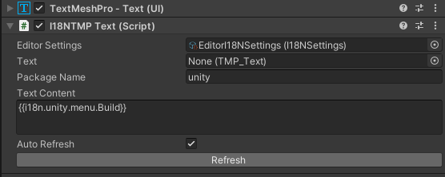
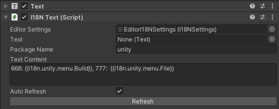
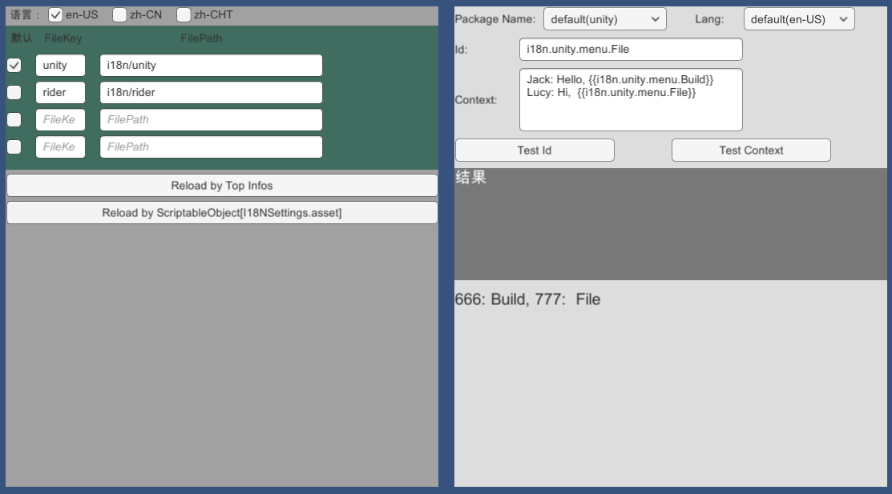

## <span id="3">3. 国际化(i18n) - 轻量级国际化解决方案

+ **JLGames.RabbitDriver.Actions.i18n** 提供了国际化模块的功能支持。插件在定义 `TMP_PRESENT` 时，用 `JLGames.RabbitDriverPro.Actions.i18n.I18NTMPText` 把 TextMeshPro 文本接到 i18n。
+ 建议使用 [BabelEdit](https://www.codeandweb.com/babeledit) 创作管理数据集。
+ 使用国际化(i18n)分为三个步骤：
  1. 准备数据。
  2. 初始化（**通过注册信息然后初始化** 或 **通过配置资产进行初始化**）。
  3. 使用。

### <span id="3.1">3.1 准备
理清楚项目的国际化需求，并准备好数据文件。  

#### <span id="3.1.1">3.1.1 理清楚项目需要支持的国际化语言种类
这里以 **英文[英文]** 、**中文[简体]**、**中文[繁体]** 举例。  

#### <span id="3.1.2">3.1.2 准备国际化数据文件
支持多个文件集，这里以两个文件集 **unity**、**rider** 举例。  
  
数据格式以 Key-Value 形式：  
  
当前测试数据集使用 Jetbrains 的 [BabelEdit](https://www.codeandweb.com/babeledit) 创作，这是一个不错的工具。  

### <span id="3.2">3.2 通过注册国际化信息进行初始化

#### <span id="3.2.1">3.2.1 向注册表注册语言。
调用 I18NRegister 实例中的 RegisterLang 函数。声明在 `I18NRegister` 中：  

```csharp
/// <summary>
/// Register a language; file suffix equals the language name.
/// 注册语言；文件后缀与语言名称相同。
/// </summary>
/// <param name="langName">Language name.<br/>语言名称。</param>
/// <param name="default">Set as default language.<br/>是否设为默认语言。</param>
public void RegisterLang(string langName, bool @default = false)

/// <summary>
/// Register a language with a custom file suffix.
/// 使用自定义文件后缀注册语言。
/// </summary>
/// <param name="langName">Language name.<br/>语言名称。</param>
/// <param name="langSuffix">Suffix used in asset file names.<br/>资源文件名中使用的后缀。</param>
/// <param name="default">Set as default language.<br/>是否设为默认语言。</param>
public void RegisterLang(string langName, string langSuffix, bool @default = false)
```

来源：`RabbitDriver-Core/RabbitDriver-Core/JLGames/RabbitDriver/Actions/i18n/Register/I18NRegister.cs`。  
+ langName 与 langSuffix 建议一样。
+ default=true 时设置当前语言为默认语言。
  
#### <span id="3.2.2">3.2.2 向注册表注册文件集加载信息
调用 I18NRegister 实例中的 RegisterFileInfo 或 RegisterFileLoadingInfo 函数。声明在 `I18NRegister` 中：  

```csharp
/// <summary>
/// Register an i18n package (file set) without loading path.
/// 注册国际化包（文件集），不含加载路径。
/// </summary>
/// <param name="i18NPackage">Package name.<br/>包名称。</param>
/// <param name="default">Set as default package.<br/>是否设为默认包。</param>
public void RegisterFileInfo(string i18NPackage, bool @default = false)

/// <summary>
/// Register an i18n package with bundle and base file path for loading.
/// 注册含资源包与基础路径的国际化包加载信息。
/// </summary>
/// <param name="i18NPackage">Package name.<br/>包名称。</param>
/// <param name="fileBundle">Asset bundle name.<br/>资源包名称。</param>
/// <param name="filePath">Base file path without suffix/extension.<br/>不含后缀与扩展名的基础文件路径。</param>
/// <param name="default">Set as default package.<br/>是否设为默认包。</param>
public void RegisterFileLoadingInfo(string i18NPackage, string fileBundle, string filePath, bool @default = false)
```

来源：`RabbitDriver-Core/RabbitDriver-Core/JLGames/RabbitDriver/Actions/i18n/Register/I18NRegister.cs`。  
+ fileKey 用于标识当前设置的文件集。
+ default=truej时设置当前文件集为默认文件集。

#### <span id="3.2.3">3.2.3 根据注册表，加载数据到管理器中
调用 II18NManager 实例中的 LoadData 函数。声明在 `II18NManager` 中：  

```csharp
/// <summary>
/// Reload localization data according to the current register configuration.
/// 根据当前注册表配置重新加载本地化数据。
/// </summary>
void LoadData();
```

来源：`RabbitDriver-Core/RabbitDriver-Core/JLGames/RabbitDriver/Actions/i18n/II18NManager.cs`。  
`I18NManagerShared.Manager.LoadData();`


**注意**：如果在过去已经执行为加载数据，那您应该先清除旧数据。`ClearData` 声明在 `II18NManager` 中：  

```csharp
/// <summary>
/// Clear all loaded localization data from memory.
/// 清除内存中已加载的全部本地化数据。
/// </summary>
void ClearData();
```

来源：`RabbitDriver-Core/RabbitDriver-Core/JLGames/RabbitDriver/Actions/i18n/II18NManager.cs`。   
`I18NManagerShared.Manager.ClearData();`


### <span id="3.3">3.3 通过配置资产进行初始化

#### <span id="3.3.1">3.3.1 生成配置资产并配置信息
1. 选择配置资产的生成目录，点击菜单"Tools/RabbitDriverPro/Project/Gen I18NSettings".  
2. 生成的资产文件名为 "I18NSettings.asset".  
3. 设置文件集的扩展名称：Asset Extension。 这里建议 "json"。  
4. 把文件集加入到Assets配置列表中。或设置其中一个为默认(**只有最后一个默认生效**)。  
  

#### <span id="3.3.3">3.3.3 通过配置资产初始化数据
调用 II18NManager 实例中的 LoadDataFromSettings 函数。声明在 `II18NManager` 中：  

```csharp
/// <summary>
/// Load localization data from a ScriptableObject settings asset.
/// 从 ScriptableObject 设置资产加载本地化数据。
/// </summary>
/// <param name="settings">I18N settings asset.<br/>国际化设置资产。</param>
void LoadDataFromSettings(I18NSettings settings);
```

来源：`RabbitDriver-Core/RabbitDriver-Core/JLGames/RabbitDriver/Actions/i18n/II18NManager.cs`。  
`I18NManagerShared.Manager.LoadDataFromSettings(settings);`


### <span id="3.4">3.4 使用

#### <span id="3.4.1">3.4.1 使用 I18NTMPText 组件，为TMP_Text增加国际化支持。
为TMP_Text节点增加 I18NTMPText 组件   
  
+ Package Name 为注册文件集时的 'i18NPackage' 参数。
+ Auto Refresh 选中时，管理器重新加载数据后会自刷新。
  
#### <span id="3.4.2">3.4.2 使用 I18NText 组件，为Text增加国际化支持。
为Text节点增加 I18NText 组件   
  
+ Package Name 为注册文件集时的 'i18NPackage' 参数。
+ Auto Refresh 选中时，管理器重新加载数据后会自刷新。

#### <span id="3.4.3">3.4.3 在代码中读取国际化数据。
调用 II18NManager 实例中的 GetValue 函数。声明在 `II18NManager` 中：  

```csharp
/// <summary>
/// Get a localized value by id using default language and default package.
/// 使用默认语言与默认包，按 id 获取本地化值。
/// </summary>
/// <param name="id">Entry key id.<br/>条目键 id。</param>
/// <returns>Localized string, or null if not found.<br/>本地化字符串，未找到时返回 null。</returns>
string GetValue(string id);

/// <summary>
/// Get a localized value by id using default language.
/// 使用默认语言，按 id 获取本地化值。
/// </summary>
/// <param name="id">Entry key id.<br/>条目键 id。</param>
/// <param name="i18NPackage">I18N package name.<br/>国际化包名称。</param>
/// <returns>Localized string, or null if not found.<br/>本地化字符串，未找到时返回 null。</returns>
string GetValue(string id, string i18NPackage);

/// <summary>
/// Get a localized value by id for the specified language and package.
/// 按 id、包与语言获取本地化值。
/// </summary>
/// <param name="id">Entry key id.<br/>条目键 id。</param>
/// <param name="i18NPackage">I18N package name.<br/>国际化包名称。</param>
/// <param name="langName">Language name.<br/>语言名称。</param>
/// <returns>Localized string, or null if not found.<br/>本地化字符串，未找到时返回 null。</returns>
string GetValue(string id, string i18NPackage, string langName);
```

来源：`RabbitDriver-Core/RabbitDriver-Core/JLGames/RabbitDriver/Actions/i18n/II18NManager.cs`。  
`I18NManagerShared.Manager.GetValue(id, i18NPackage, langName);`


#### <span id="3.4.4">3.4.4 在代码中把文本内容进行国际化。
在文件内容中支持脚本格式： `{{id}}`。调用 II18NManager 实例中的 GetContent 函数。声明在 `II18NManager` 中：  

```csharp
/// <summary>
/// Resolve placeholders in content using default language and default package.
/// 使用默认语言与默认包，解析内容中的占位符（如 {{id}}）。
/// </summary>
/// <param name="content">Template content with placeholders.<br/>含占位符的模板内容。</param>
/// <returns>Resolved content string.<br/>解析后的内容字符串。</returns>
string GetContent(string content);

/// <summary>
/// Resolve placeholders in content using default language.
/// 使用默认语言，解析内容中的占位符。
/// </summary>
/// <param name="content">Template content with placeholders.<br/>含占位符的模板内容。</param>
/// <param name="i18NPackage">I18N package name.<br/>国际化包名称。</param>
/// <returns>Resolved content string.<br/>解析后的内容字符串。</returns>
string GetContent(string content, string i18NPackage);

/// <summary>
/// Resolve placeholders in content for the specified language and package.
/// 按包与语言解析内容中的占位符。
/// </summary>
/// <param name="content">Template content with placeholders.<br/>含占位符的模板内容。</param>
/// <param name="i18NPackage">I18N package name.<br/>国际化包名称。</param>
/// <param name="langName">Language name.<br/>语言名称。</param>
/// <returns>Resolved content string.<br/>解析后的内容字符串。</returns>
string GetContent(string content, string i18NPackage, string langName);
```

来源：`RabbitDriver-Core/RabbitDriver-Core/JLGames/RabbitDriver/Actions/i18n/II18NManager.cs`。  
`I18NManagerShared.Manager.GetContent(content, i18NPackage, langName);`


### <span id="3.5">3.5 示例
Assets/JLGames/RabbitDriverPro/Samples/i18n  
  