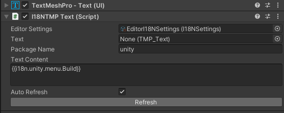
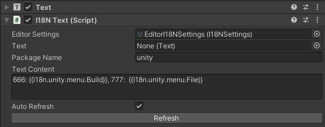
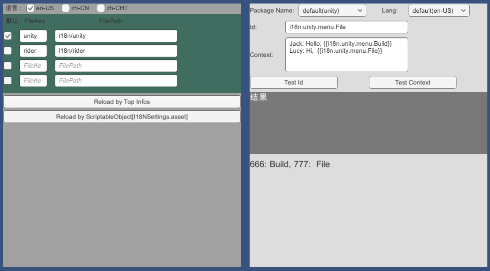

## <span id="3">3. Internationalization (i18n) - Lightweight Internationalization Solution

+ **JLGames.RabbitDriver.Actions.i18n** provides the internationalization module. When `TMP_PRESENT` is defined, the plugin's `JLGames.RabbitDriverPro.Actions.i18n.I18NTMPText` binds TextMeshPro text to i18n.
+ [BabelEdit](https://www.codeandweb.com/babeledit) is recommended for authoring management datasets.
+ Use internationalization (i18n) in three steps:
   1. Prepare the data.
   2. Initialize (**Initialize by registering information** or **Initialize by configuring assets**).
   3. Use.

### <span id="3.1">3.1 Preparation
Understand the internationalization requirements of the project and prepare data files.   

#### <span id="3.1.1">3.1.1 Clarify the types of international languages ​​that the project needs to support
Here are **English[English]**, **Chinese[Simplified]**, **Chinese[Traditional]** as examples.  

#### <span id="3.1.2">3.1.2 Prepare internationalization data files
Multiple file sets are supported, here are two file sets **unity**, **rider** for example.  
  
The data format is in the form of Key-Value:  
  
The current test dataset is authored using Jetbrains' [BabelEdit]  (https://www.codeandweb.com/babeledit), which is a nice tool.  

### <span id="3.2">3.2 Initialize by registering internationalization informations

#### <span id="3.2.1">3.2.1 Register languages with the registry.
Call the RegisterLang function in the I18NRegister instance. Declared on `I18NRegister`:  

```csharp
/// <summary>
/// Register a language; file suffix equals the language name.
/// 注册语言；文件后缀与语言名称相同。
/// </summary>
/// <param name="langName">Language name.<br/>语言名称。</param>
/// <param name="default">Set as default language.<br/>是否设为默认语言。</param>
public void RegisterLang(string langName, bool @default = false)

/// <summary>
/// Register a language with a custom file suffix.
/// 使用自定义文件后缀注册语言。
/// </summary>
/// <param name="langName">Language name.<br/>语言名称。</param>
/// <param name="langSuffix">Suffix used in asset file names.<br/>资源文件名中使用的后缀。</param>
/// <param name="default">Set as default language.<br/>是否设为默认语言。</param>
public void RegisterLang(string langName, string langSuffix, bool @default = false)
```

Source: `RabbitDriver-Core/RabbitDriver-Core/JLGames/RabbitDriver/Actions/i18n/Register/I18NRegister.cs`.  
+ langName as langSuffix suggests.
+ default=true sets the current language as the default language.
  
#### <span id="3.2.2">3.2.2 Loading information to the registry registration file set
Call the RegisterFileInfo or RegisterFileLoadingInfo function in the I18NRegister instance. Declared on `I18NRegister`:  

```csharp
/// <summary>
/// Register an i18n package (file set) without loading path.
/// 注册国际化包（文件集），不含加载路径。
/// </summary>
/// <param name="i18NPackage">Package name.<br/>包名称。</param>
/// <param name="default">Set as default package.<br/>是否设为默认包。</param>
public void RegisterFileInfo(string i18NPackage, bool @default = false)

/// <summary>
/// Register an i18n package with bundle and base file path for loading.
/// 注册含资源包与基础路径的国际化包加载信息。
/// </summary>
/// <param name="i18NPackage">Package name.<br/>包名称。</param>
/// <param name="fileBundle">Asset bundle name.<br/>资源包名称。</param>
/// <param name="filePath">Base file path without suffix/extension.<br/>不含后缀与扩展名的基础文件路径。</param>
/// <param name="default">Set as default package.<br/>是否设为默认包。</param>
public void RegisterFileLoadingInfo(string i18NPackage, string fileBundle, string filePath, bool @default = false)
```

Source: `RabbitDriver-Core/RabbitDriver-Core/JLGames/RabbitDriver/Actions/i18n/Register/I18NRegister.cs`.  
+ fileKey is used to identify the currently set fileset.
+ default=truej Set the current fileset as the default fileset.

#### <span id="3.2.3">3.2.3 According to the registry, load data into the manager
Call the LoadData function in the II18NManager instance. Declared on `II18NManager`:  

```csharp
/// <summary>
/// Reload localization data according to the current register configuration.
/// 根据当前注册表配置重新加载本地化数据。
/// </summary>
void LoadData();
```

Source: `RabbitDriver-Core/RabbitDriver-Core/JLGames/RabbitDriver/Actions/i18n/II18NManager.cs`.  
`I18NManagerShared.Manager.LoadData();`  


**NOTE**: If you have performed load data in the past, you should clear the old data first. `ClearData` is declared on `II18NManager`:  

```csharp
/// <summary>
/// Clear all loaded localization data from memory.
/// 清除内存中已加载的全部本地化数据。
/// </summary>
void ClearData();
```

Source: `RabbitDriver-Core/RabbitDriver-Core/JLGames/RabbitDriver/Actions/i18n/II18NManager.cs`.  
`I18NManagerShared.Manager.ClearData();`  


### <span id="3.3">3.3 Initialize by configuring asset

#### <span id="3.3.1">3.3.1 Generate configuration assets and configure information
1. Select the generation directory of the configuration assets, click the menu "Tools/RabbitDriverPro/Project/Gen I18NSettings".  
2. The generated asset file is named "I18NSettings.asset".  
3. Set the extension name of the fileset: Asset Extension. "json" is suggested here.  
4. Add the fileset to the Assets configuration list. Or set one of them as default (**only the last default takes effect**).  
  

#### <span id="3.3.3">3.3.3 Initializing data by configuring assets
Call the LoadDataFromSettings function in the II18NManager instance. Declared on `II18NManager`:  

```csharp
/// <summary>
/// Load localization data from a ScriptableObject settings asset.
/// 从 ScriptableObject 设置资产加载本地化数据。
/// </summary>
/// <param name="settings">I18N settings asset.<br/>国际化设置资产。</param>
void LoadDataFromSettings(I18NSettings settings);
```

Source: `RabbitDriver-Core/RabbitDriver-Core/JLGames/RabbitDriver/Actions/i18n/II18NManager.cs`.  
`I18NManagerShared.Manager.LoadDataFromSettings(settings);`  


### <span id="3.4">3.4 Use

#### <span id="3.4.1">3.4.1 Use the I18NTMPText component to add internationalization support to TMP_Text.
Add I18NTMPText component to TMP_Text node  
  
+ Package Name is the 'i18NPackage' parameter when registering a file set.
+ Auto Refresh When checked, the manager will refresh itself after reloading the data.
  
#### <span id="3.4.2">3.4.2 Use the I18NText component to add internationalization support to Text.
Add I18NText component to Text node  
  
+ Package Name is the 'i18NPackage' parameter when registering a file set.
+ Auto Refresh When checked, the manager will refresh itself after reloading the data.

#### <span id="3.4.3">3.4.3 Reading internationalized data in code.
Call the GetValue function in the II18NManager instance. Declared on `II18NManager`:  

```csharp
/// <summary>
/// Get a localized value by id using default language and default package.
/// 使用默认语言与默认包，按 id 获取本地化值。
/// </summary>
/// <param name="id">Entry key id.<br/>条目键 id。</param>
/// <returns>Localized string, or null if not found.<br/>本地化字符串，未找到时返回 null。</returns>
string GetValue(string id);

/// <summary>
/// Get a localized value by id using default language.
/// 使用默认语言，按 id 获取本地化值。
/// </summary>
/// <param name="id">Entry key id.<br/>条目键 id。</param>
/// <param name="i18NPackage">I18N package name.<br/>国际化包名称。</param>
/// <returns>Localized string, or null if not found.<br/>本地化字符串，未找到时返回 null。</returns>
string GetValue(string id, string i18NPackage);

/// <summary>
/// Get a localized value by id for the specified language and package.
/// 按 id、包与语言获取本地化值。
/// </summary>
/// <param name="id">Entry key id.<br/>条目键 id。</param>
/// <param name="i18NPackage">I18N package name.<br/>国际化包名称。</param>
/// <param name="langName">Language name.<br/>语言名称。</param>
/// <returns>Localized string, or null if not found.<br/>本地化字符串，未找到时返回 null。</returns>
string GetValue(string id, string i18NPackage, string langName);
```

Source: `RabbitDriver-Core/RabbitDriver-Core/JLGames/RabbitDriver/Actions/i18n/II18NManager.cs`.  
`I18NManagerShared.Manager.GetValue(id, i18NPackage, langName);`  


#### <span id="3.4.4">3.4.4 Internationalize the text content in the code.
Support script format in the file content: `{{id}}`. Call the GetContent function in the II18NManager instance. Declared on `II18NManager`:  

```csharp
/// <summary>
/// Resolve placeholders in content using default language and default package.
/// 使用默认语言与默认包，解析内容中的占位符（如 {{id}}）。
/// </summary>
/// <param name="content">Template content with placeholders.<br/>含占位符的模板内容。</param>
/// <returns>Resolved content string.<br/>解析后的内容字符串。</returns>
string GetContent(string content);

/// <summary>
/// Resolve placeholders in content using default language.
/// 使用默认语言，解析内容中的占位符。
/// </summary>
/// <param name="content">Template content with placeholders.<br/>含占位符的模板内容。</param>
/// <param name="i18NPackage">I18N package name.<br/>国际化包名称。</param>
/// <returns>Resolved content string.<br/>解析后的内容字符串。</returns>
string GetContent(string content, string i18NPackage);

/// <summary>
/// Resolve placeholders in content for the specified language and package.
/// 按包与语言解析内容中的占位符。
/// </summary>
/// <param name="content">Template content with placeholders.<br/>含占位符的模板内容。</param>
/// <param name="i18NPackage">I18N package name.<br/>国际化包名称。</param>
/// <param name="langName">Language name.<br/>语言名称。</param>
/// <returns>Resolved content string.<br/>解析后的内容字符串。</returns>
string GetContent(string content, string i18NPackage, string langName);
```

Source: `RabbitDriver-Core/RabbitDriver-Core/JLGames/RabbitDriver/Actions/i18n/II18NManager.cs`.  
`I18NManagerShared.Manager.GetContent(content, i18NPackage, langName);`  


### <span id="3.5">3.5 Example
Assets/JLGames/RabbitDriverPro/Samples/i18n  
  